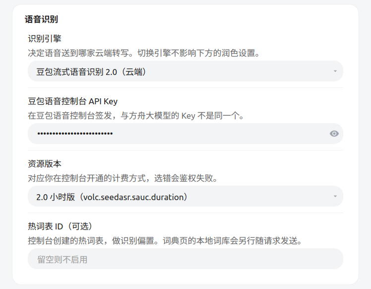
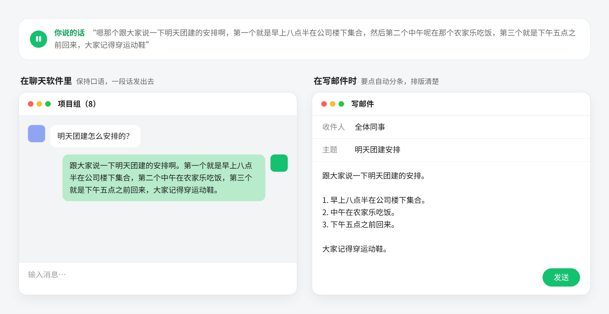
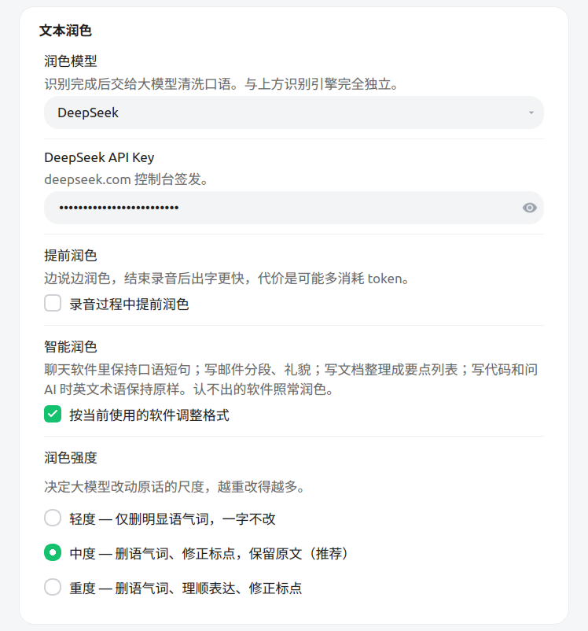
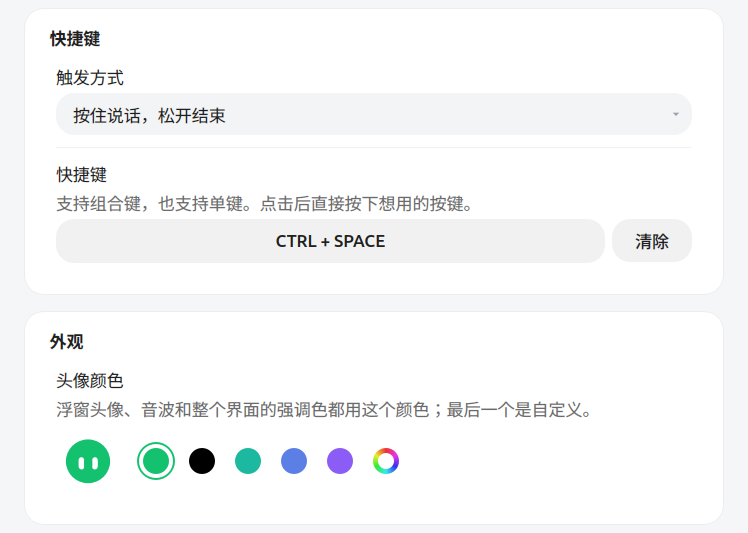
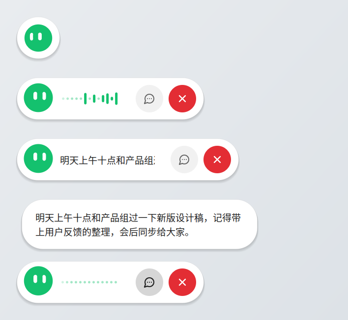
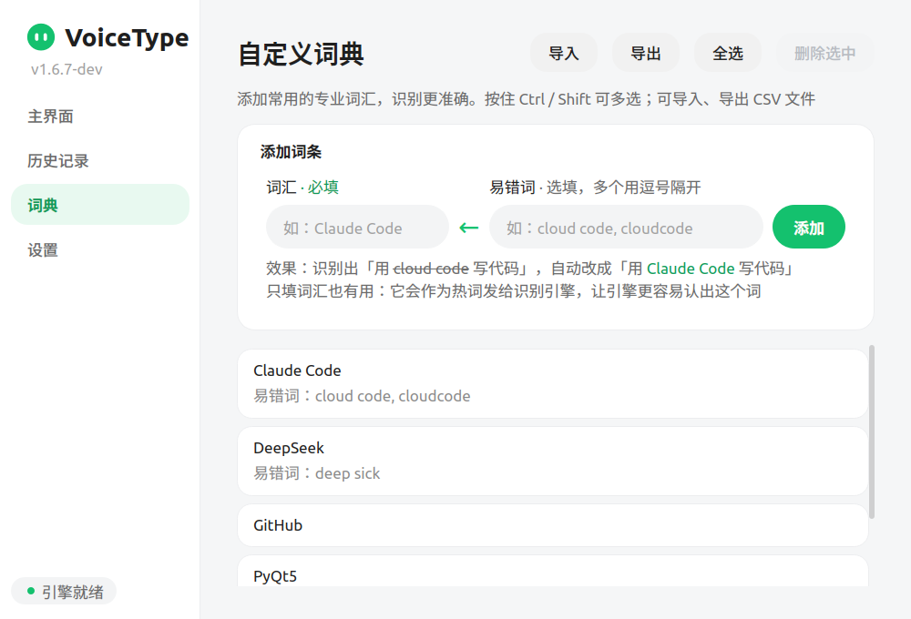

# VoiceType · Linux 上的 AI 语音输入

[](https://github.com/hongyan199048/voice_typing/releases)
[](LICENSE)

**按住快捷键说话，松开后文字自动出现在光标处。** 写文档、回消息、发邮件、写代码，凡是能打字的地方都能用。

<p align="center"></p>

## 它能做什么

- **说完就上屏**：识别好的文字直接粘贴到你正在打字的位置，不用复制粘贴。
- **边说边看**：屏幕底部有个小浮窗，说话时显示音量和识别到的文字。
- **自动整理**：用 AI 去掉「嗯、啊、那个」，补上标点，说错改口的地方只保留最后的说法。
- **智能润色**：在聊天软件里保持口语，写邮件时分段、语气礼貌，写文档时整理成要点。
- **专业词汇认得准**：把常用的人名、术语加进词典，识别时就不会再写错。
- **有表情的小助手**：浮窗里的圆头会跟着你说话的情绪变表情，闲着的时候也会眨眼、张望、打瞌睡。

## 安装

到 [Releases 页面](https://github.com/hongyan199048/voice_typing/releases/latest)下载最新版，根据你的系统选一个文件：

| 系统 | 下载这个 | 安装方法 |
|---|---|---|
| Ubuntu / Debian | `voice-typing_版本号_amd64.deb` | 在下载目录打开终端，运行 `sudo apt install ./voice-typing_*.deb` |
| Fedora / RHEL | `voice-typing-版本号.x86_64.rpm` | `sudo dnf install ./voice-typing-*.rpm` |
| 其他发行版 | `VoiceType-版本号-x86_64.AppImage` | 右键 → 属性，打开「允许作为程序执行」，然后双击运行 |

装好后，在应用列表里搜索 **VoiceType** 打开。

> Ubuntu 请用上面的 `apt install` 命令安装，不要用 `dpkg -i`，否则依赖不会自动装上。<br>
> AppImage 版还需要先装两个小工具：`sudo apt install xclip xdotool`。

<details>
<summary>想用一条命令下载并安装？</summary>

```bash
# Ubuntu / Debian
URL=$(curl -s https://api.github.com/repos/hongyan199048/voice_typing/releases/latest \
  | grep "browser_download_url.*_amd64\.deb" | cut -d '"' -f 4)
wget -O voice-typing.deb "$URL" && sudo apt install ./voice-typing.deb
```

</details>

## 第一次使用：三步设置好

第一次打开会直接进入设置页。

**① 填语音识别的 API Key**

选一个识别引擎（推荐「豆包流式语音识别 2.0」），把申请到的 Key 粘贴进去。去哪申请见下文的 [API Key 申请](#去哪申请-api-key)。



**② （可选）打开 AI 润色**

选一个润色模型（DeepSeek、智谱 GLM 或 MiniMax），填上对应的 Key。不想用的话选「关闭润色」，文字会按识别原样输出。

**智能润色** 默认开启，会按你当前使用的软件自动调整格式。比如同一段话，在飞书、微信里保持聊天的口吻，在文档里整理成一条一条的要点。不需要的话取消勾选即可。

同一段话，在聊天软件里和在邮件里出来的效果（真实润色结果）：





**③ 设置快捷键**

点快捷键那一栏，直接按下你想用的键（比如 `Ctrl + 空格`，或者单独一个键）。触发方式可以选「按住说话，松开结束」，也可以选「按一下开始，再按一下结束」。



最后点页面底部的 **确定** 保存，就可以开始用了。

## 日常怎么用

1. 把光标点到要输入文字的地方，比如聊天框或文档里。
2. 按下快捷键（或者**单击浮窗里的圆头**），开始说话。
3. 说完松开快捷键（或者再点一下圆头），稍等一下，文字就会出现在光标处。



从上到下依次是：

- **平时**：屏幕底部只有一个圆头，可以按住拖到任何位置。
- **说话中**：浮窗展开，显示音量波形。
- **识别出文字**：波形换成文字，边说边更新。
- **聊天模式**：点浮窗上的 💬 按钮，文字会显示在上方的大气泡里，长句子看得更全。

说到一半发现说错了？点红色的 **✕**，这次的内容会直接作废，什么都不会粘贴。

圆头会根据你说的话变表情，闲着的时候还会做些小动作：


在设置页的「外观」里可以给它换颜色，整个界面的主题色也会跟着变。

## 自定义词典

总被识别错的词，比如人名、产品名、专业术语，加到词典里就行。

- **词汇**：正确的写法，会提示给识别引擎，让它更容易认出这个词。
- **易错词**：常被识别成的错误写法，出现时自动替换成正确的词汇。

词典可以导入、导出成 CSV 文件，用 Excel 编辑后再导入也行。



## 主页与历史记录

主页显示累计用了多少分钟、输入了多少字。「历史记录」里保留最近 100 条结果，误删了也能找回来复制。


## 去哪申请 API Key

| 用途 | 服务 | 申请地址 |
|---|---|---|
| 语音识别 | 豆包流式语音识别（推荐） | [豆包语音控制台 → API Key](https://console.volcengine.com/speech/new/setting/apikeys)，首次使用要先在左侧「开通管理」里开通语音识别模型 |
| 语音识别 | 阿里云 Paraformer | [阿里云百炼控制台](https://bailian.console.aliyun.com/)，右上角头像 → 「API-KEY 管理」 |
| AI 润色 | DeepSeek | [platform.deepseek.com](https://platform.deepseek.com/) |
| AI 润色 | 智谱 GLM | [bigmodel.cn](https://bigmodel.cn/) |
| AI 润色 | MiniMax | [minimaxi.com](https://www.minimaxi.com/) |

这些都是按用量计费的云服务，日常打字的用量一般很小。

## 常见问题

**按快捷键没反应？**
VoiceType 需要 X11 桌面。在终端运行 `echo $XDG_SESSION_TYPE`，如果输出 `wayland`，请在登录界面右下角的齿轮里改选「Ubuntu on Xorg」后重新登录。

**文字没有粘贴上去？**
先确认光标停在输入框里。AppImage 版要装好 `xclip` 和 `xdotool`（见上文「安装」）。

**关掉窗口后程序还在吗？**
还在。关闭窗口只是缩到右上角的托盘里，快捷键照常可用；双击托盘图标可以重新打开。

**想开机自动启动？**
在设置页最下方勾选「开机自动启动 VoiceType」。

## 许可

[MIT License](LICENSE)
